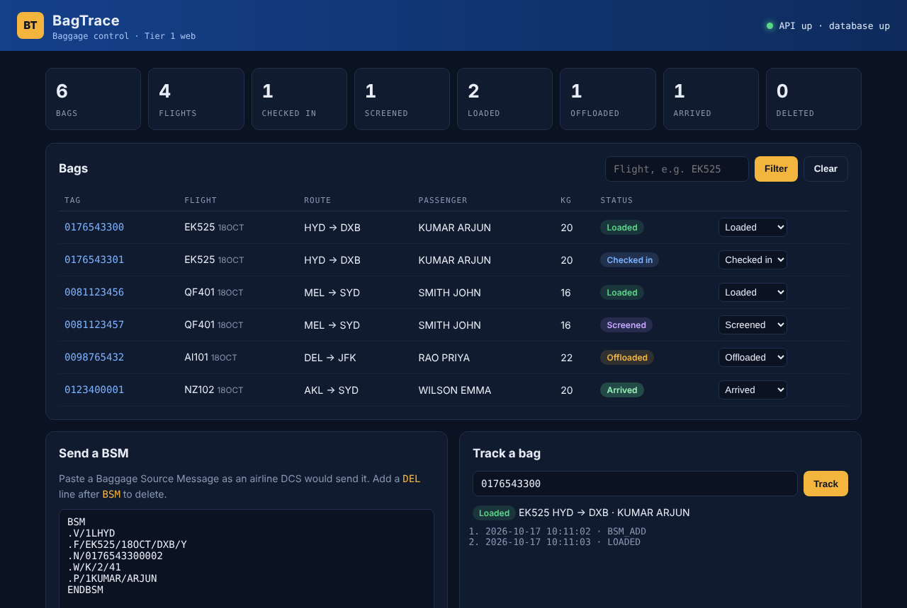
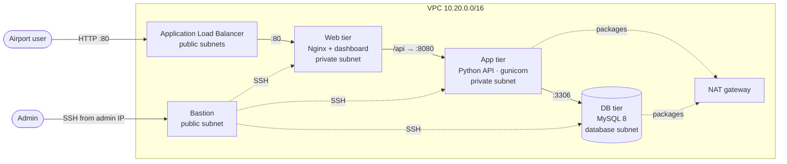

# BagTrace · 3-tier DevOps project

[](https://github.com/RavindraSurathu/bagtrace-devops/actions/workflows/ci.yml)

BagTrace is an airport baggage-tracking system. It ingests **IATA Baggage Source Messages (BSM)**, the messages an airline's departure control system sends when a bag is checked in, and tracks each bag by tag and flight.

I built it to practise taking one application from manual server setup all the way to Kubernetes. The same 3-tier app is deployed **five ways**:

| # | Method | Folder | What it shows |
|---|--------|--------|---------------|
| 1 | Shell scripts | [`shell/`](shell) | Idempotent installs with logging and validation, systemd, AWS CLI provisioning |
| 2 | Ansible | [`ansible/`](ansible) | Roles per tier, handlers, Ansible Vault for secrets |
| 3 | Terraform | [`terraform/`](terraform) | AWS VPC with public/private/database subnets, tier-to-tier security groups, ALB, bastion |
| 4 | Docker Compose | [`docker-compose.yml`](docker-compose.yml) | Multi-stage non-root images, health checks, isolated networks |
| 5 | Kubernetes | [`k8s/`](k8s) | StatefulSet + PVC, Deployments, HPA, Ingress (ALB), NetworkPolicies, Kustomize |

Every push runs **GitHub Actions**: unit tests, ShellCheck, `terraform validate`, an Ansible syntax check, Kubernetes schema validation, and image builds pushed to GHCR.



## Architecture



Each security group only accepts traffic from the tier directly in front of it. The database has no route from the internet, and SSH is allowed only from the bastion, which is reachable only from your own IP.

### How a bag flows through the system

1. An airline DCS (or you, in the dashboard) sends a BSM to `POST /api/bsm`.
2. The API parses the message: `.V` station, `.F` flight, `.N` tag numbers, `.W` weight, `.P` passenger.
3. Each tag becomes a row in MySQL with status `CHECKED_IN`, and an event is logged.
4. Ground staff move the bag through `SCREENED → LOADED → ARRIVED`, or `OFFLOADED`.
5. A **DELBSM** (a BSM with a `DEL` line) marks the bag `DELETED`, for example when a passenger doesn't board.

```text
BSM
.V/1LHYD
.F/EK525/18OCT/DXB/Y
.N/0176543300002        ← tag 0176543300, 2 consecutive tags
.W/K/2/41               ← 2 pieces, 41 kg in total
.P/1KUMAR/ARJUN
ENDBSM
```

## Repository layout

```text
app/
  backend/     Flask API: BSM parser, MySQL storage, Prometheus metrics, tests, Dockerfile
  frontend/    Dashboard (HTML/JS/CSS), Nginx config template, Dockerfile
  db/          MySQL schema and sample data
shell/         common.sh + one install script per tier, systemd unit, EC2 launcher
ansible/       site.yml, roles/{common,mysql,backend,frontend}, vault example
terraform/     VPC, security groups, EC2 with user_data bootstrap, ALB, outputs
k8s/           Namespace, MySQL StatefulSet, backend + HPA, frontend + Ingress, NetworkPolicies
.github/       CI pipeline
```

## Run it

### 1. Docker Compose (quickest, runs locally)

```bash
docker compose up -d --build
open http://localhost:8080
```

### 2. Shell scripts (one RHEL 9 server per tier)

```bash
# Optional: create the three instances and Route 53 records
AMI_ID=ami-xxxx SG_ID=sg-xxxx ZONE_ID=Zxxxx DOMAIN=example.com ./shell/launch-instances.sh mysql backend frontend

# On each server, after cloning this repo:
sudo MYSQL_ROOT_PASSWORD='...' DB_PASSWORD='...' ./shell/01-mysql.sh          # mysql server
sudo DB_HOST=mysql.example.com DB_PASSWORD='...' ./shell/02-backend.sh         # backend server
sudo BACKEND_HOST=backend.example.com ./shell/03-frontend.sh                   # frontend server
```

Logs are written to `/var/log/bagtrace/<script>.log`. Every step is checked with `VALIDATE`, and re-running a script is safe.

### 3. Ansible

```bash
cd ansible
ansible-galaxy collection install -r requirements.yml
cp group_vars/all/vault.example.yml group_vars/all/vault.yml   # set real passwords
ansible-vault encrypt group_vars/all/vault.yml
# edit inventory.ini and group_vars/all/main.yml with your hosts/domain
ansible-playbook site.yml --ask-vault-pass
```

### 4. Terraform (full AWS environment)

```bash
cd terraform
cp terraform.tfvars.example terraform.tfvars   # key pair name + your IP
terraform init
terraform plan
terraform apply
terraform output app_url        # open after ~5 minutes of bootstrapping
```

Each instance clones this repo at boot and runs its `shell/` script, so the shell scripts are reused rather than rewritten.
**Cost:** the NAT gateway, ALB and four RHEL instances are outside the free tier and cost several US dollars a day. Run `terraform destroy` as soon as you're done.

### 5. Kubernetes (EKS, minikube or kind)

```bash
kubectl apply -k k8s/
kubectl -n bagtrace get pods,svc,ingress
```

On EKS the Ingress creates an ALB through the AWS Load Balancer Controller. On minikube or kind, set `ingressClassName: nginx` in `k8s/30-frontend.yaml`, or run `kubectl -n bagtrace port-forward svc/frontend 8080:80`.

## API

| Method | Path | Description |
|--------|------|-------------|
| `POST` | `/api/bsm` | Process a BSM (plain text, or JSON `{"message": "..."}`) |
| `GET` | `/api/bags?flight=EK525` | List bags, optionally filtered by flight |
| `GET` | `/api/bags/{tag}` | One bag with its event history |
| `PATCH` | `/api/bags/{tag}` | Update status: `{"status": "LOADED"}` |
| `GET` | `/api/stats` | Counts by status and number of flights |
| `GET` | `/health` | Readiness: API and database |
| `GET` | `/health/live` | Liveness: API process only |
| `GET` | `/metrics` | Prometheus metrics (requests, latency, messages processed) |

Run the tests locally:

```bash
cd app/backend
pip install -r requirements.txt pytest
pytest -q
```

## Design decisions

- **Same config, every platform.** One Nginx template (`app/frontend/nginx.conf.template`) is rendered by `envsubst` in the shell script, by Jinja2 in Ansible, and by the official Nginx image's template feature in Docker and Kubernetes.
- **Least privilege between tiers.** AWS security groups, Docker networks and Kubernetes NetworkPolicies all enforce web → app → db, so the frontend can never reach MySQL directly.
- **Readiness vs liveness.** `/health` checks the database and gates traffic; `/health/live` only checks the process, so a database outage doesn't restart every API pod.
- **Non-root everywhere.** The API runs as a dedicated system user under systemd, and as UID 10001 with a read-only root filesystem in Kubernetes.
- **Secrets.** Ansible uses Vault and Kubernetes uses a Secret. Terraform generates random passwords; in production I'd move them to AWS Secrets Manager instead of user_data.

## Next steps

- Helm chart and Argo CD for GitOps deployments
- Terraform module for EKS, with remote state in S3
- Prometheus and Grafana dashboards for the `/metrics` endpoint
- Amazon RDS in place of self-managed MySQL

## Credits

The project structure follows the 3-tier and microservices projects (Expense, RoboShop) from the [Joindevops](https://www.joindevops.com) DevOps course. The BagTrace application, its aviation domain and all code in this repository were written for this portfolio.

---

**Ravindra Surathu** · Cloud Infrastructure & DevOps Engineer · [Portfolio](https://ravindrasurathu.github.io) · [LinkedIn](https://www.linkedin.com/in/ravindra-surathu/)
